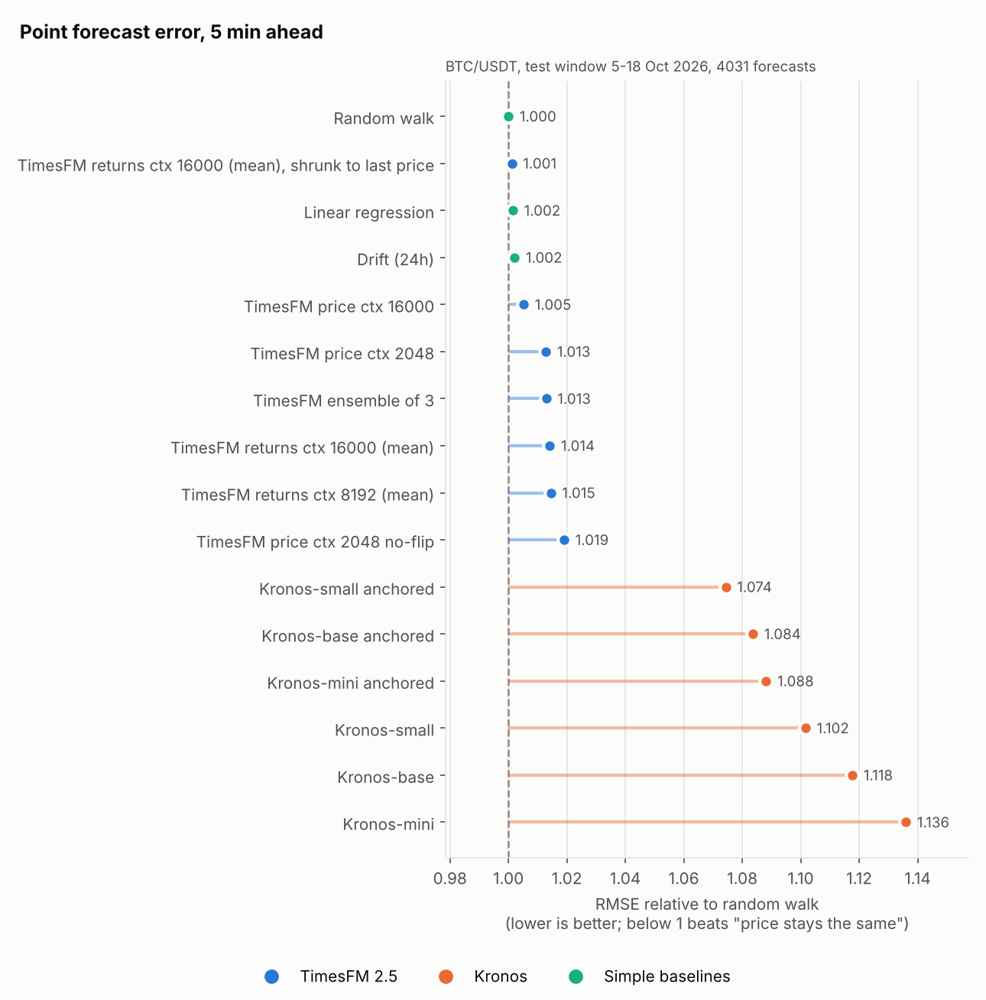
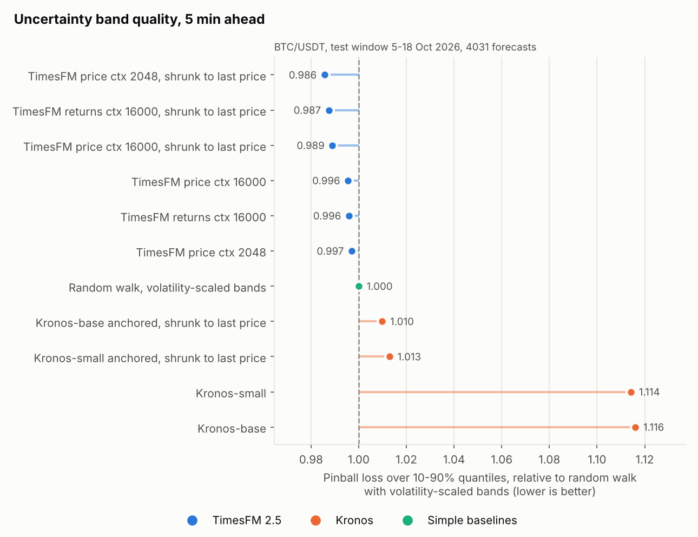
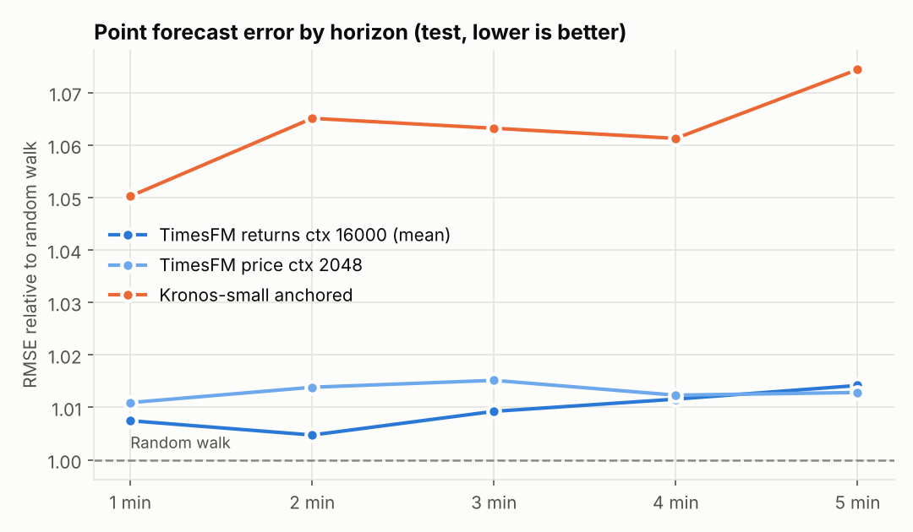
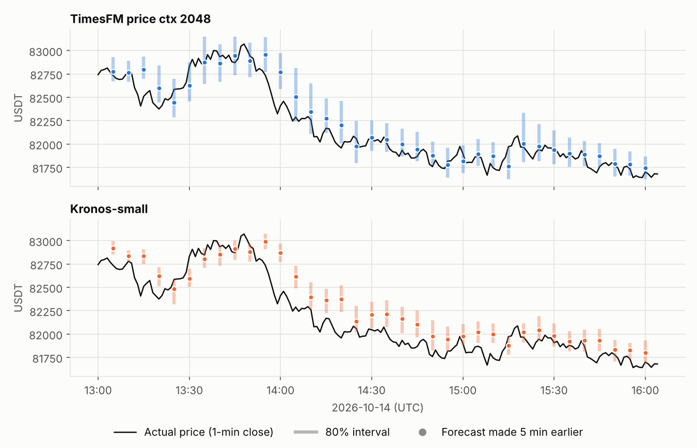

# TimesFM vs Kronos: BTC price 5 minutes ahead

A rolling-origin backtest of **TimesFM 2.5 (200M)** at forecasting the Bitcoin
price 1–5 minutes ahead, tuned as far as the data allowed. **Kronos** (mini,
small and base), a foundation model trained on financial candlesticks, is
scored on exactly the same forecasts for comparison.

## TL;DR

Test window: 5–18 Oct 2026, BTC/USDT 1-minute bars from Binance, 4,031
forecasts made every 5 minutes (non-overlapping). BTC traded at 80.1k–86.9k
USDT, and the average absolute 5-minute move was 6.5 bps (≈ $54).

* **No model beats "the price stays where it is" (random walk) at 5 minutes.**
  TimesFM's point forecasts miss by $54–55 on average (MAPE ≈ 0.065%), while
  the random walk misses by $53.6. Every raw TimesFM setup has 0.5–4% higher
  RMSE than the random walk, and most of these gaps are statistically
  significant (Diebold–Mariano p < 0.05).
* **Direction is a coin flip**: 49–52% at 5 minutes for every model, with
  nothing that survives the number of variants tried.
* **TimesFM's uncertainty bands are its real strength.** Re-centred on the last
  price, TimesFM's 10–90% quantiles score **1.4% better pinball loss** than a
  random walk with volatility-scaled empirical bands (DM = −5.5, p < 0.0001).
  In other words, it estimates *how much* BTC will move in the next 5
  minutes better than a rolling-volatility model does, even though it can't
  tell *which way*.
* **Kronos is clearly worse than TimesFM**: 10–14% higher RMSE than the random
  walk at 5 minutes and 24–38% at 1 minute. Its 80% intervals contain the
  outcome only 58–68% of the time. Much of the gap comes from its tokenizer's
  reconstruction error. An "anchored" variant fixes part of it (1.07–1.09 at
  5 minutes, 1.05–1.13 at 1 minute) but still trails TimesFM.

This is the expected outcome for a liquid market at a 5-minute horizon:
price changes are almost unpredictable, so the realistic bar for "accurate"
is matching the random walk while getting the *spread* right. TimesFM gets
the spread right, and matches the random walk once its point forecast is
shrunk to the last price. Kronos does neither out of the box.





## Results (test split)

`RMSE vs RW` < 1 means more accurate than the random walk. `DM p` is the
Diebold–Mariano test on squared error vs the random walk. Pinball loss is
averaged over the 10–90% quantiles, in bps of price. `80% cov` is how often
the truth fell inside the 10–90% band (ideal: 80%).

| model | MAE $ (5m) | MAE bps | RMSE vs RW (5m) | DM p | dir. acc. (5m) | RMSE vs RW (1m) | dir. acc. (1m) | pinball bps | 80% cov |
|---|---|---|---|---|---|---|---|---|---|
| Random walk (vol-scaled bands) | 53.6 | 6.46 | 1.000 | – | – | 1.000 | – | 2.618 | 80% |
| Drift (24h mean return) | 53.8 | 6.48 | 1.002 | 0.010 | 49.5% | 1.000 | 49.5% | 2.625 | 80% |
| Linear regression on recent returns | 53.6 | 6.46 | 1.002 | 0.174 | 49.9% | 1.000 | 49.7% | 2.621 | 80% |
| TimesFM price, ctx 2048 (out of the box) | 54.4 | 6.56 | 1.013 | 0.030 | 49.4% | 1.011 | 50.3% | 2.610 | 82% |
| TimesFM price, ctx 16000 | 54.2 | 6.53 | 1.005 | 0.191 | 50.3% | 1.026 | 49.9% | 2.606 | 85% |
| TimesFM price, ctx 2048, no flip-invariance | 54.7 | 6.60 | 1.019 | 0.004 | 49.8% | 1.021 | 48.7% | 2.631 | 82% |
| TimesFM returns, ctx 16000 (mean) — **best on validation** | 54.1 | 6.52 | 1.014 | 0.014 | 49.6% | 1.007 | 51.3% | 2.607 | 75% |
| TimesFM returns, ctx 16000 (median) | 54.0 | 6.51 | 1.011 | 0.022 | 49.6% | 1.008 | 52.0% | 2.607 | 75% |
| TimesFM returns, ctx 8192 (mean) | 54.2 | 6.53 | 1.015 | 0.011 | 49.1% | 1.009 | 52.0% | 2.612 | 75% |
| TimesFM ensemble of 3 best on validation | 54.1 | 6.52 | 1.013 | 0.017 | 49.5% | 1.008 | 51.7% | 2.608 | 75% |
| TimesFM price ctx 2048, shrunk to last price | 53.6 | 6.46 | 1.000 | – | – | 1.000 | 50.3% | **2.581** | 82% |
| TimesFM returns ctx 16000, shrunk to last price | 53.6 | 6.46 | 1.001 | 0.186 | 49.6% | 1.006 | 51.3% | 2.587 | 75% |
| Kronos-mini | 62.5 | 7.53 | 1.136 | <0.001 | 50.3% | 1.376 | 50.1% | 2.996 | 65% |
| Kronos-small | 59.0 | 7.11 | 1.102 | <0.001 | 50.9% | 1.240 | 49.9% | 2.917 | 58% |
| Kronos-base | 59.3 | 7.15 | 1.118 | <0.001 | 50.9% | 1.275 | 49.9% | 2.922 | 59% |
| Kronos-small, anchored | 57.8 | 6.97 | 1.074 | <0.001 | 51.4% | 1.050 | 49.7% | 2.862 | 58% |
| Kronos-base, anchored | 58.0 | 6.99 | 1.084 | <0.001 | 51.7% | 1.084 | 49.7% | 2.857 | 60% |

Full tables (all variants, validation and test, h = 1 and 5) are in
`results/summary_*.csv`. Per-horizon errors are in
`results/test_relRMSE_by_horizon.csv`.





## What was done to make TimesFM as accurate as possible

All choices were made on a **validation window (21 Sep – 4 Oct 2026, 1,344
forecasts)**, and the test window was only used for the final runs.

1. **Context length** swept from 128 to 16,000 one-minute bars (the model
   limit is 16,384 − horizon). Longer is better: relative RMSE improves
   from 1.050 at ctx 128 to about 1.007–1.015 at 2k–16k.
2. **Input representation**: raw price, 1-minute log-returns (forecast
   returns, then cumulate back to price), and 5-minute-sampled prices.
   Returns at long context were best on validation. 5-minute sampling was
   about as good as 1-minute bars covering the same span of history, not
   better.
3. **Flip invariance** (`force_flip_invariance`) on/off: mixed, and off was
   slightly worse on test.
4. **Point estimate**: median vs TimesFM's mean output channel.
5. **Ensembling** the 3 best validation variants.
6. **Shrinkage toward the last price** with a factor α per horizon, fit by
   least squares on validation. α comes out at 0–0.32 for price inputs. For
   returns inputs it goes from 0.74–0.93 at 1 minute down to 0–0.17 at 5
   minutes. The data are saying TimesFM's predicted *move* carries almost no
   information beyond 1 minute.

On validation, returns-input TimesFM looked promising at 1 minute (51–55%
direction accuracy, 0.2–0.4% lower RMSE than the random walk, not
significant). On test this shrank to 51–52% and 0.7–1% *higher* RMSE, so it
did not hold up.

### Validation sweep (5-minute-ahead RMSE vs random walk, median point forecast)

| config | rel. RMSE | config | rel. RMSE |
|---|---|---|---|
| ensemble of 3 (returns 16k mean + median, 8k mean) | 1.0047 | price ctx 4096 | 1.0135 |
| returns ctx 16000 | 1.0069 | price ctx 2048 | 1.0135 |
| returns ctx 8192 | 1.0070 | price ctx 8192 | 1.0149 |
| price ctx 2048, no flip | 1.0073 | 5-min price ctx 1024 | 1.0158 |
| returns ctx 4096 | 1.0090 | returns ctx 512 | 1.0194 |
| 5-min price ctx 2048 | 1.0092 | price ctx 1024 | 1.0243 |
| price ctx 16000 | 1.0106 | price ctx 512 | 1.0251 |
| returns ctx 2048 | 1.0119 | price ctx 128 | 1.0503 |

## Kronos details

* Models `NeoQuasar/Kronos-{mini,small,base}` with their tokenizers. Input
  is full OHLCV + amount with timestamp features, normalised per window as in
  `KronosPredictor`. Sampling uses the library defaults T = 1.0, top_p =
  0.9, with **100 sampled paths per forecast**. The mean is the point
  forecast and the empirical 10–90% quantiles are the bands.
* The reference sampler re-runs the whole 512-token window for every sample
  and every step (roughly 20 s per forecast with 32 samples on a 4-core
  runner, vs 1.4 s with 100 samples for Kronos-base after the change below).
  `scripts/kronos_fast.py` encodes the context once, caches its keys and
  values, and decodes each path token by token, the same for the causal
  tokenizer decoder. It is **mathematically the same computation**:
  `tests/test_kronos_fast.py` checks it against Kronos' own
  `auto_regressive_inference` (greedy decoding, random weights), and every
  Actions job repeats that check on the real weights (max diff 3.6e-7). This
  requires a lookback of 508 (512 − 5 + 1) so the window never slides; for
  mini it is 2,044.
* With 100 samples, Monte-Carlo noise in the averaged forecast inflates RMSE
  by under 1% (`relRMSE_MCcorr` in the CSVs removes it), so that isn't why
  Kronos trails.
* Kronos's averaged forecast sits a few bps off the last close, and that
  offset is uncorrelated with the actual move (it comes from its discrete
  tokenizer). The **anchored** variant (not part of stock Kronos) applies
  Kronos's predicted *change* to the true last close:
  `last + (forecast − Kronos's own reconstruction of the last bar)`.

## Method

* **Data**: Binance BTCUSDT 1-minute klines, 1 Jul – 18 Oct 2026, with no
  gaps (`data/btcusdt_1m.csv.gz`, fetched by `scripts/fetch_data.py` from
  Binance's public S3 archive).
* **Task**: at origin *t* (bar *t* just closed), forecast the close of bars
  *t+1…t+5*. The headline metric is the 5-minute-ahead close.
* **Splits**: validation 21 Sep – 4 Oct (every 15 min); test 5 – 18 Oct (every
  5 min, so 5-minute targets don't overlap). Up to 16,000 minutes of history
  before each origin are available to every model.
* **Baselines**: random walk with volatility-scaled empirical quantiles
  (240-min realised vol × standardised return quantiles from Jul–Sep), 24h
  drift, and OLS on 1/5/15/60/240-minute returns plus relative volume (fit on
  Jul–Sep only).
* **TimesFM**: `timesfm` 3.0.2 package, TimesFM 2.5 200M Flax checkpoint
  (from Google's public Vertex Model Garden bucket), CPU, fp32,
  `normalize_inputs=True`, `fix_quantile_crossing=True`.
* **Significance**: Diebold–Mariano with Newey–West variance (h − 1 lags).

## Caveats

* Two weeks of test data from one market regime, for one asset. The
  conclusions about *relative* accuracy (random walk ≈ TimesFM > Kronos) are
  statistically solid for this window, but magnitudes will vary by regime.
* The returns-input quantiles for multi-step horizons are approximated by
  adding per-step spreads in quadrature (assumes independent steps). That is
  why their coverage is lower (75%).
* Only zero-shot models were tested. Fine-tuning either model on BTC data
  might change the picture, though the random-walk bar is hard to clear at
  this horizon.
* TimesFM 3.0 (Aug 2026, non-commercial weights) was not tested because its
  weights are only on Hugging Face, which the original sandbox could not
  reach. It can be added to the Actions workflow the same way as Kronos.

## Reproduce

```bash
python -m venv .venv && . .venv/bin/activate
pip install "jax[cpu]" flax optax einshape orbax-checkpoint jaxtyping numpy pandas matplotlib
pip install --no-deps timesfm==3.0.2
# TimesFM 2.5 Flax checkpoint -> checkpoints/timesfm-2.5-200m-flax
#   (see the "Download checkpoint" step in .github/workflows/timesfm.yml)

python scripts/fetch_data.py                      # data/btcusdt_1m.csv.gz
python scripts/baselines.py                       # random walk, drift, linreg
python scripts/run_timesfm.py --split test --mode returns --context 16000
scripts/grid_validation.sh                        # short-context validation sweep
python scripts/report.py && python scripts/plots.py
```

Long-context TimesFM runs and all Kronos runs go through GitHub Actions: edit
`ci/timesfm_plan.json` or `ci/kronos_plan.json` and push. Jobs are sharded,
and merged predictions are committed back to `results/`. On a GPU machine
`scripts/run_kronos.py` runs as-is (`--kronos-path` pointing at a clone of
`shiyu-coder/Kronos`).

## Layout

```
scripts/common.py         splits, forecast origins, metrics (DM test, pinball, coverage)
scripts/fetch_data.py     Binance 1m klines
scripts/baselines.py      random walk / drift / linear regression
scripts/run_timesfm.py    TimesFM 2.5 backtest (price / returns / 5-min inputs, sharding)
scripts/run_kronos.py     Kronos backtest (100 sampled paths per forecast, sharding)
scripts/kronos_fast.py    exact shared-prefix KV-cache sampler for Kronos
scripts/merge_*.py        merge Actions shards
scripts/report.py         tables, shrinkage, ensemble -> results/summary_*.csv
scripts/plots.py          figures/
tests/test_kronos_fast.py fast sampler == reference sampler
results/                  every prediction file (preds_*.npz) and summaries
```
